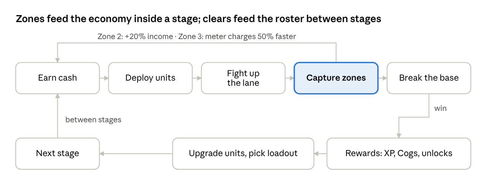

## 4. Core battle loop

A stage is a 3-to-5-minute auto-combat tug-of-war on one vertical lane: earn cash, spend it on units and bank upgrades, capture zones, break the enemy base. The player never controls a unit after deploying it; all skill is in what to deploy, when, and what to spend the Command Meter on.

Text version: see diagrams.md

The top row repeats many times inside one stage; the bottom row runs once per clear and feeds the next stage's opening.

### 4.1 Battlefield

- One lane, logical length 1,000 units. Player base at the bottom (y = 0), enemy base at the top (y = 1,000). Units travel along y only; x is cosmetic jitter so stacks read as crowds.
- Zones: Zone 1 = y 0-333, Zone 2 = y 333-667, Zone 3 = y 667-1,000. A side captures a zone when its frontline (its foremost living unit) has been inside it for 4 s with no enemy unit inside it. Capture is lost when the other side's frontline enters and holds for 4 s. Zone 2 gives its holder +20% income; Zone 3 gives +50% Command Meter charge rate; Zone 1 does nothing but is the last line.
- Bases have HP (player base 10,000 on every stage; enemy base authored per stage, 6,000-120,000). Bases do not attack. A base takes damage from any unit in range of it.
- Camera: the viewport shows roughly 45% of the lane and tracks the midpoint between the two frontlines with a 0.4 s lerp. A thin lane bar on the screen's right edge always shows the full lane, zone ownership, both frontlines and both base HPs. Dragging on the battlefield pans to peek; release snaps back after 1.5 s. No pinch zoom.

### 4.2 Economy

Cash is earned passively from the Bank, from enemy bounties, and from zone bonuses. It is spent on units and Bank upgrades. Cash does not persist between stages.

| Bank level | Income / s | Wallet cap | Cost to upgrade to next |
| --- | --- | --- | --- |
| 1 | 20 | 1,500 | 350 |
| 2 | 26 | 2,000 | 550 |
| 3 | 33 | 2,600 | 800 |
| 4 | 42 | 3,300 | 1,100 |
| 5 | 52 | 4,100 | 1,450 |
| 6 | 64 | 5,000 | 1,850 |
| 7 | 78 | 6,000 | 2,300 |
| 8 | 95 | 7,200 | max |

Buying every upgrade back-to-back from zero takes about 175 s of pure saving, so on a 4-minute stage the player cannot both max the Bank and spend freely. That tension is the stage's first decision. Enemy bounty = 25% of the enemy's cost value (an authored stat); killing the wave pays for about a quarter of the next one. Starting cash and starting Bank level are per-stage fields (default 0 cash, level 1) so tutorials and boss stages can skip the opening.

### 4.3 Deployment and combat

- The loadout holds 8 unit cards. Tapping a card spawns that unit at the player base if cash is at least its cost and the card's cooldown is ready. Cost is deducted, cooldown starts. No queueing; a tap during cooldown shakes the card.
- Units walk up the lane at their speed until an enemy is within their range, then stop and attack on their attack interval. Attacks have a wind-up (foreswing) so slow heavy hitters can be interrupted by knockback.
- Knockback model: a unit's HP is split into N equal knockback segments. Each time cumulative damage crosses a segment boundary the unit is pushed back 60 units and its current attack is cancelled. This is the mechanic that makes tanks, pushers and long-range units feel different, and it is fully readable on screen.
- Damage is single-target by default; Area units hit everything in their range. Traits (Section 6.3) modify damage and effects against tagged enemies.
- There is no friendly fire, no unit limit other than cost and cooldown, and no unit despawns except by death.

### 4.4 Command Meter

One meter per stage, 0-100, charging at 2.2 per second (45 s to full; 30 s while holding Zone 3). The player equips 2 Commands from the pool they have unlocked. Each Command costs the full meter.

| Command | Unlocked in | Effect |
| --- | --- | --- |
| Blast | Tutorial | 1,200 damage (scales with Bank level × 150) to every enemy in the viewport; 1 knockback to all |
| Bulwark | World 1 | A wall at your frontline that absorbs 4,000 damage or lasts 8 s; enemies stop at it |
| Rally | World 2 | All allied units +50% move speed and +30% damage for 6 s |
| Surge | World 3 | Instantly +40% of wallet cap in cash |
| Frost | World 4 | All enemies in viewport slowed 60% for 5 s; stops boss wind-ups |
| Beacon | World 5 | The next 3 units deployed within 10 s cost 0 and have no cooldown |

### 4.5 Win, lose, stars

- Win: enemy base HP reaches 0. Lose: player base HP reaches 0. No timer; stages may optionally define a soft time par for the third star.
- Stars: 1 = win; 2 = win with player base above 50% HP; 3 = stage-specific condition (under par time, no Bank above level 4, only 6 cards, no Commands used, etc.). Stars feed world-gate totals (Section 8) but are never required at 100%.
- Loss screen shows the cause in one line ("Lost to Shieldbacks: they resist ranged damage. Try Hammerhead.") drawn from the stage's authored hint table, then Retry (one tap, same loadout) or Edit loadout.

### 4.6 Stage flow and timing

1. World map tap → Stage card (enemy preview with trait icons, enemy base HP, star conditions, rewards, recommended power).
2. Loadout (8 cards + 2 Commands; last-used preset preselected) → Start. Target: 15 s from map tap to first unit deployed.
3. Battle, 3-5 min for a main stage, 5-8 min for a boss stage. Speed toggle 1x / 2x; pause anywhere.
4. Result: stars, XP, currencies, drops, any unlock, "Next stage" button. Target under 20 s with no forced animation longer than 2 s and all skippable.

The per-stage budget used for the 30-hour calculation in Section 10 is 6 min for a main stage and 8 min for side stages and trials, including a retry rate of 1.4 attempts per first clear.
