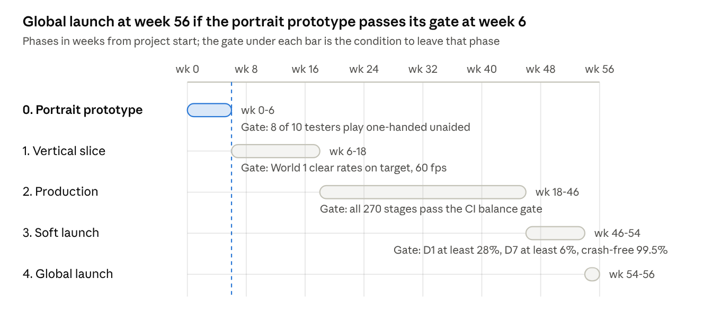

## 15. Production plan

About 13 months from a 6-week portrait prototype to global launch with a core team of 8, provided the prototype gate passes; the single biggest schedule risk is the vertical lane itself, which is why it is tested before anything else is built. Estimates assume the stage editor and CI balance gate exist before content production starts.

Text version: see diagrams.md

The dashed line is the only gate that can kill the concept; everything after it is schedule risk, not design risk.

### 15.1 Phases and gates

| Phase | Weeks | Delivers | Gate to leave the phase |
| --- | --- | --- | --- |
| 0. Portrait prototype | 6 | Grey-box vertical lane, 6 units, 8 enemies, 5 stages, zones, Blast, Bank; playable one-handed on device | 10 external testers: 8 of 10 can play 1-5 one-handed without instruction; 7 of 10 say they would play more; median first-win under 2 min |
| 1. Vertical slice | 12 | World 1 complete with final art for 12 units and the Rustlings, tutorial, FTUE, results, map, save, stage editor, headless gate in CI | World 1 first-clear rates within 15 points of Section 8.2 targets across 10 testers; 60 fps on reference devices |
| 2. Production | 28 | Worlds 2-6, side campaigns, trials, 40 units with forms, all bosses, retention layer (P0), Armory, shop, cloud save, localization | All 270 stages pass the CI gate; two playtest rounds per world done; P0 list complete |
| 3. Soft launch | 8 | Live in 2-3 test markets (e.g. Canada, Philippines, Finland); analytics, A/B on tutorial length and Day-7 reward; balance patches | D1 ≥ 28%, D7 ≥ 6% in soft-launch cohorts; crash-free ≥ 99.5%; World 2 boss conversion to Full Campaign measured |
| 4. Global launch | 2 | Store launch, first monthly event ready, LiveOps calendar for 6 months |  |

### 15.2 Team

| Role | Count | Notes |
| --- | --- | --- |
| Producer / game director | 1 | Owns this document and the balance targets |
| Gameplay engineer | 2 | Simulation core, presentation, platform |
| Tools engineer | 1 | Stage editor, CI gate, content pipeline; joins Phase 1 |
| Level designer | 2 | One from Phase 1, two in Phase 2 |
| Character artist and animator | 1 + 1 (contract) | 40 units × 3 forms, 72 enemies, 18 bosses |
| Environment and UI artist | 1 | 6 worlds, HUD, map, collection |
| Audio | contract | 14 tracks, SFX library |
| QA | 1 | Device matrix, regression, playtest coordination |

### 15.3 Content velocity assumptions

- Stages: with the editor and gate, one level designer tunes about 8 main stages or 5 boss/trial stages per week. 180 main stages at 8 per week is 22.5 designer-weeks; 60 side stages and 30 trials at 5 per week is 18 designer-weeks; bosses and retunes add roughly 10. That is about 50 designer-weeks against 56 available from two designers over the 28-week production phase, so only 10% slack; a third designer for the final 12 weeks restores about 25%.
- Units: a fully animated base unit takes about 2.5 artist-days; Form II about 0.5 day; Form III about 1.5 days. 40 units is roughly 180 artist-days, or 36 weeks for one artist, so the contract animator is on the critical path from Phase 1.
- Enemies: 72 enemies at 1.5 days plus 18 bosses at 5 days is about 200 artist-days, split between the character artist and the animator.

### 15.4 Playtest cadence

Weekly internal play sessions from Phase 0; external one-handed device tests at every gate and after each world in production; a standing panel of 20 testers recruited from the prototype cohort. Every test records the holding hand and a screen capture so reach problems are seen, not reported.

### 15.5 Post-launch

The first six months follow the LiveOps cadence in Section 11.4 with one quarterly content drop (a 7th world or two side campaigns) already in production during soft launch, so that launch week does not drain the pipeline.
