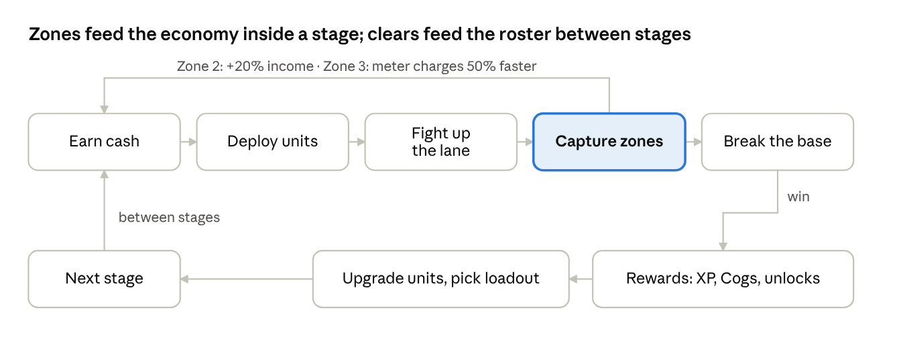
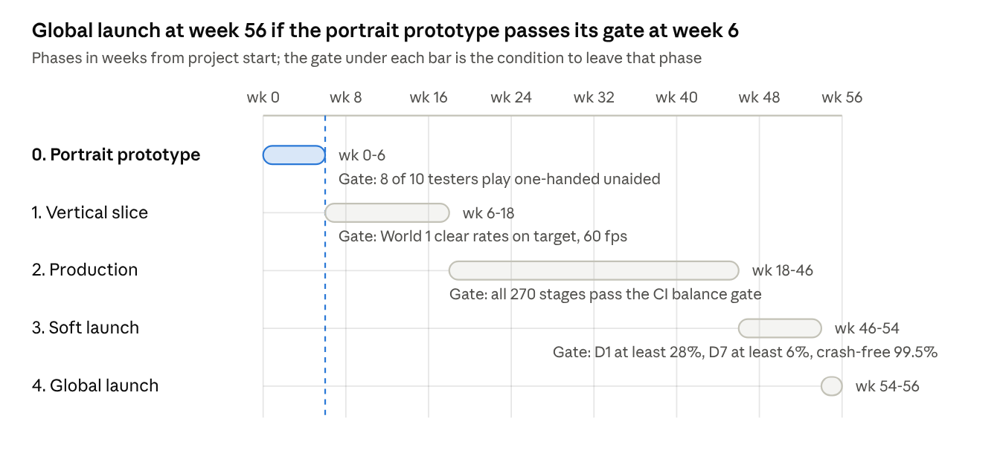

# Game Design Document: Portrait 2D Lane Battler (Battle Bricks-inspired)

Nov 2, 2026 · Draft v0.1 · Source doc: https://claude.ai/artifact/JaYUa1RxAdzXRfq4iEuPpe

## 1. Overview

**PUSHLINE (working title)** is an original, portrait-only, one-thumb 2D lane battler for iOS and Android: you deploy units from the bottom of the screen, they march up a vertical lane, and the stage is won when the enemy base at the top falls before yours at the bottom does. It takes the proven structure of The Battle Bricks (Roblox) and The Battle Cats (mobile) and rebuilds it as a single-player, level-based campaign with at least 30 hours of first-clear content and no mandatory grinding.

### Constraints this document is built to satisfy

These come from the brief and are treated as hard requirements, not preferences.

| # | Constraint | How it shows up in this design |
| --- | --- | --- |
| C1 | Portrait-only, playable one-handed | Vertical lane; every tappable control inside the bottom 40% of the screen; no gestures that need two fingers |
| C2 | Fully playable solo; no multiplayer dependency | No co-op, no PvP, no social gates; leaderboards are asynchronous and optional |
| C3 | Level / wave / world based, not creative or open-world | Fixed world map, authored stages, authored waves; no sandbox or building |
| C4 | 30+ hours of meaningful first-clear content | 270 authored challenges (180 main stages, 60 side stages, 30 trials) budgeted at 30.0 h; grinding does not count |
| C5 | No pop-culture IP, no brainrot, no gambling loops | Original characters, art and names; no gacha for core units; no loot-box RNG gating progress |
| C6 | Roblox-grade retention design plus Battle Bricks' gameplay standards | Section 11 (retention) and Section 6-9 (gameplay depth) implement the checklists agreed in the brief |
| C7 | Mobile quality bar | 60 fps target, 44 pt touch targets, 99.5% crash-free sessions, auto-save and instant retry (Section 14) |

### Design pillars

1. **Read the lane, not the manual.** Every enemy's threat and every unit's role is legible from its silhouette and behaviour on screen. If a player needs the encyclopedia to survive, the stage is misdesigned.
2. **Every stage asks a new question.** A stage exists only if it introduces, tests or twists a mechanic. Stat-inflated repeats are cut, not shipped.
3. **Progress by clearing, not farming.** Clearing the campaign at its intended pace must fund all required upgrades. Replaying a stage is a choice, never a toll.
4. **One thumb, full control.** Deployment, abilities, speed and pause are all reachable by the right or left thumb without re-gripping the phone. Switching hands is supported with a mirror layout.

### What this document is and is not

This is a buildable v0.1 design: systems, formulas, content budgets, schemas and production plan. It is not a balance sheet of final numbers; every tunable value is marked as a starting point to be validated in playtests (Section 9.5). Figures taken from outside sources are cited inline and gathered in Section 18.

## 2. Research summary

Three findings change the earlier brief: The Battle Bricks does run a gacha and stat-multiplied replays, so it is a looser reference than assumed; no shipped Battle Cats-like plays in portrait, so the vertical lane is unproven and must be prototyped first; and the brief's retention targets sit in the top decile of published mobile benchmarks, so they are stretch goals, not baselines. Figures below are as of 2 November 2026; access caveats are noted where a source could not be opened directly.

### 2.1 The Battle Bricks (Roblox, Tumore / solo developer)

| Fact | Value | Source |
| --- | --- | --- |
| Scale | 147.2 M visits, 320.7 K favourites, 6.94 M unique players, typical concurrency 1.9-2.1 K, average session 20.5 min, all-time peak 40,066 on 19 Jun 2026 (Chapter 5 launch) | [rowatcher](https://rowatcher.com/games/3913007563/the-battle-bricks), [rotrends](https://rotrends.com/game/3913007563) |
| Rating | 186,260 likes / 33,817 dislikes (84.6%) | [Rolimon's](https://www.rolimons.com/game/10834586502) |
| Campaign | 5 main chapters of 30 stages (6 and 7 planned), challenge stages at 5/15/25, bosses at 10/20, final boss at 30; 13 sub-chapters totalling 226 stages; replays pay 35% XP | [namu wiki, main chapters](https://www.namu.moe/w/The%20Battle%20Bricks/%EB%A9%94%EC%9D%B8%20%EC%B1%95%ED%84%B0) |
| Difficulty | Star tiers multiply enemy stats, base HP and unit costs by 1x / 1.5x / 2x; Casual, Normal and Tumore modes; 1x-6x enemy multiplier slider for bonus XP | same |
| Battle economy | In-battle bank levels to 8, six bank types (Investment, Powerhouse, Detonator, Ignition, Bloodaltar); eight cannon types on a 45 s recharge; out-of-battle base upgrades bought with XP | [namu wiki, banks](https://www.namu.moe/w/The%20Battle%20Bricks/%EC%9D%80%ED%96%89), [cannons](https://www.namu.moe/w/The%20Battle%20Bricks/%ED%94%8C%EB%A0%88%EC%9D%B4%EC%96%B4%EC%9D%98%20%EB%8C%80%ED%8F%AC) |
| Units | About 90-100 battlers in five rarities, each with an alt form at level 10; +20% of base stat per level; level cap rises +5 per chapter cleared; anti-trait units deal +25% / take -25% versus Red, Death, Angel, Zombie | [namu wiki, battlers](https://www.namu.moe/w/The%20Battle%20Bricks/%EB%B0%B0%ED%8B%80%EB%9F%AC) |
| Gacha | 100-200 Bricks per pull at 70% Rare / 25% Super Rare / 5% Uber; Uberfest doubles Uber odds; no game passes, 5 developer products | [namu wiki, systems](https://www.namu.moe/w/The%20Battle%20Bricks/%ED%8A%B9%EC%A7%95%20%EB%B0%8F%20%EA%B2%8C%EC%9E%84%20%EC%8B%9C%EC%8A%A4%ED%85%9C), [Roblox game-pass API](https://apis.roblox.com/game-passes/v1/universes/3913007563/game-passes) |
| Anti-farm rules | Boss alive = your base cannot be damaged; since 13 Sep 2025 the enemy base is invulnerable until the scripted spawn cycle finishes | same |
| Retention systems | Daily login streak paying Bricks (resets after 20 h since Chapter 5), badges, anniversary and Uberfest events; no quest system found | same |

Two earlier claims in the brief do not survive this: Battle Bricks is not gacha-free, and its star system is stat inflation of the same stages. We keep its loadout, bank, cannon, trait and chapter structure and drop those two. Loadout size (8) appears only in secondary sources and is unverified on the fan wiki.

### 2.2 The Battle Cats (PONOS)

- Structure: Empire of Cats is 3 chapters of 48 stages that reuse the same stage designs at rising difficulty; Into the Future and Cats of the Cosmos repeat that pattern; Stories of Legend, Uncanny Legends and Zero Legends add dozens of sub-chapters ([Wikipedia](https://en.wikipedia.org/wiki/The_Battle_Cats)).
- In-battle economy: Worker Cat with 8 levels per battle, cost rising per level; Cat Cannon with a 10-bar charge and infinite range; hitting the enemy base often triggers stronger spawns ([Worker Cat](https://battle-cats.fandom.com/wiki/Worker_Cat), [Cat Cannon](https://battle-cats.fandom.com/wiki/Cat_Cannon)).
- Monetisation: Cat Food premium currency for gacha (150 per roll), energy refills and continues; energy gates stage attempts ([Cat Food](https://battle-cats.fandom.com/wiki/Cat_Food)).
- Scale: over $700 M lifetime revenue by Aug 2024, 68% from Japan; 78 M downloads ([Sensor Tower via WN Hub](https://wnhub.io/news/finance/item-44495)). Landscape-only; the orientation is visible in store screenshots but we found no text source stating it.

### 2.3 Portrait precedents

- Clash Royale gives the player's half of the arena and the card hand the bottom roughly three-quarters of the screen and was built for one-thumb play ([Game Developer](https://www.gamedeveloper.com/design/breaking-down-supercell-s-next-hit-clash-royale)). Castle Crush rotates the lane battler vertical with three lanes and castles at each end ([Level Winner](https://www.levelwinner.com/?p=8275)). Rush Royale puts the player's board at the bottom and the opponent's mirrored at the top ([Pocket Gamer](https://www.pocketgamer.com/rush-royale/rush-royale-hands-on-mixing-a-bunch-of-great-genres-together)).
- No shipped single-lane, base-versus-base auto-battler in the Battle Cats mould uses a vertical lane. PUSHLINE's layout is therefore a design bet to be validated in the first prototype (Section 15).

### 2.4 Retention benchmarks

| Metric | All-genre median | Top 25% | Top 10% | Strategy median (2024 data) |
| --- | --- | --- | --- | --- |
| D1 | \~22% | just over 30% | \~40% | 19-21% |
| D7 | just under 4% | 6-7% | \~12% | 3.2-3.6% |
| D30 (D28 for genre) | 0.7-0.8% | 1.6-1.8% | \~4% | 0.66-0.77% |
| Session length | 3.1-3.5 min | \~5.2 min |  | 5.3-5.6 min |
| Sessions per day | 3.8-3.9 | 5.3-5.7 |  | 4.2-4.4 |

Sources: [GameAnalytics 2026 Mobile & PC Gaming Benchmarks](https://investgame.net/wp-content/uploads/2026/01/2026-01-27-2026-mobile-pc-benchmarks_compressed.pdf) (2025 data, 16,262 games), [GameAnalytics Mobile retention benchmarks 2026](https://investgame.net/wp-content/uploads/2026/01/2026-01-20-Mobile_retention_benchmarks_2026.pdf), [GameAnalytics 2025 benchmarks](https://gameanalytics.com/reports/2025-mobile-gaming-benchmarks) for the genre split. GameAnalytics notes that top studios keep data private, so public figures skew low. The brief's targets (D1 30-35%, D7 8-10%, D30 2-3%) are top-quartile to top-decile; Section 16 keeps them as stretch targets and adds floor targets.

### 2.5 Platform guidelines used in this design

- Apple: 44 × 44 pt default control size, 28 pt minimum, frequent controls near the thumbs, secondary controls at the top, respect safe areas, teach through play ([HIG: Designing for games](https://developer.apple.com/design/human-interface-guidelines/designing-for-games), [HIG: Game controls](https://developer.apple.com/design/human-interface-guidelines/game-controls)).
- Android: core loop at a minimum of 30 fps and 60 fps or more for reaction-based games on capable devices; keep game state across rotation and resize ([Android game quality](https://developer.android.com/quality/technical)). Android vitals flags user-perceived crash rates above 1.09% and ANR above 0.47% ([Android vitals](https://developer.android.com/games/optimize/vitals)).

### 2.6 Level-design references

The campaign template in Section 8.2 is built from three sources: Nintendo's four-step introduce / develop / twist / conclude structure ([Nintendo Life on Hayashida's GDC talk](https://www.nintendolife.com/news/2015/03/video_nintendos_four_step_stage_design_is_why_you_love_super_mario_games_so_much)), George Fan's tutorial rules from Plants vs. Zombies ([Game Developer](https://gamedeveloper.com/design/gdc-2012-10-tutorial-tips-from-i-plants-vs-zombies-i-creator-george-fan)), and the Kingdom Rush campaign analysis of one-concept-per-level with each new enemy targeting a known weakness ([Game Developer](https://gamedeveloper.com/design/kingdom-rush---the-wonderful-campaign-level-design)).

## 3. Positioning and differentiation

A faithful Battle Bricks or Battle Cats port is not a product: Battle Cats already owns the landscape, gacha-driven version of this genre, and Battle Bricks is free on Roblox. PUSHLINE's slot is **the portrait, one-thumb, solo, gacha-free, campaign-complete lane battler**, and it earns that slot with one original tactical hook rather than a longer feature list.

### Competitive frame

| Game | Orientation | Core model | Progress gated by | What we take | What we reject |
| --- | --- | --- | --- | --- | --- |
| The Battle Cats (PONOS) | Landscape | Side-view lane battler, auto-combat | Gacha units, energy, treasure RNG | Deploy-timing economy, unit roles, chapter structure | Gacha as the main unit source, energy timers |
| The Battle Bricks (Roblox) | Landscape (2.5D) | Battle Cats structure, single-player | XP grind, stage drops | Loadouts, bank upgrade, cannon, traits, bosses, daily track | XP grinding, one-solution late stages |
| Castle Crush | Portrait | Vertical lane, card deployment, PvP | Card rarity, ladder | Vertical-lane readability, bottom card bar | Multiplayer dependency, card chase |
| Grow Castle | Portrait | Base defense, enemies walk in from one side | Idle upgrades | Portrait idle-friendly HUD | Idle/AFK economy |
| Plants vs. Zombies 2 | Landscape | Lane defense, grid placement | Level unlocks, some premium plants | World-based mechanic introduction, mechanic-per-world | Grid placement (needs precision taps) |

### The hook: Momentum zones

The lane is divided into three visible zones between the two bases. Whichever side's frontline occupies a zone for 4 seconds captures it. Captured zones change the battle:

- **Zone 1 (yours by default):** no effect. Losing it means the enemy is at your gate.
- **Zone 2 (middle):** holder gains +20% cash income. This is the fight most stages revolve around.
- **Zone 3 (enemy's by default):** holder's Command Meter charges 50% faster. Taking it is how you set up the kill on the enemy base.

Stage scripts can hang events on zone captures: "when the player captures Zone 2, spawn the elite", "when the player loses Zone 1, spawn 3 reinforcements". That gives level designers a second axis of pacing (space) on top of waves (time), and it gives the player a readable mid-stage goal other than "survive". It is also what makes a single vertical lane, which could feel thin, read as a tug-of-war.

### Secondary hook: Command Meter with a choice

Battle Cats has one timed cannon; Battle Bricks lets you pick one of eight cannon types before a battle (Section 2.1). PUSHLINE goes one step further: one meter and two equipped Commands (chosen before the stage from a pool that grows through the campaign). Spending the meter on a wall instead of a blast is a decision, and which two Commands to bring is a loadout decision. Both hooks are built entirely from single taps, so they cost nothing against constraint C1.

### What we deliberately keep simple

Units are never micro-controlled. There are no sub-lanes, no grid, no drag placement. The player's whole input vocabulary is: tap a unit card, tap a Command, tap bank upgrade, tap speed, tap pause.

## 4. Core battle loop

A stage is a 3-to-5-minute auto-combat tug-of-war on one vertical lane: earn cash, spend it on units and bank upgrades, capture zones, break the enemy base. The player never controls a unit after deploying it; all skill is in what to deploy, when, and what to spend the Command Meter on.



The top row repeats many times inside one stage; the bottom row runs once per clear and feeds the next stage's opening.

### 4.1 Battlefield

- One lane, logical length 1,000 units. Player base at the bottom (y = 0), enemy base at the top (y = 1,000). Units travel along y only; x is cosmetic jitter so stacks read as crowds.
- Zones: Zone 1 = y 0-333, Zone 2 = y 333-667, Zone 3 = y 667-1,000. A side captures a zone when its frontline (its foremost living unit) has been inside it for 4 s with no enemy unit inside it. Capture is lost when the other side's frontline enters and holds for 4 s. Zone 2 gives its holder +20% income; Zone 3 gives +50% Command Meter charge rate; Zone 1 does nothing but is the last line.
- Bases have HP (player base 10,000 on every stage; enemy base authored per stage, 6,000-120,000). Bases do not attack. A base takes damage from any unit in range of it.
- Camera: the viewport shows roughly 45% of the lane and tracks the midpoint between the two frontlines with a 0.4 s lerp. A thin lane bar on the screen's right edge always shows the full lane, zone ownership, both frontlines and both base HPs. Dragging on the battlefield pans to peek; release snaps back after 1.5 s. No pinch zoom.

### 4.2 Economy

Cash is earned passively from the Bank, from enemy bounties, and from zone bonuses. It is spent on units and Bank upgrades. Cash does not persist between stages.

| Bank level | Income / s | Wallet cap | Cost to upgrade to next |
| --- | --- | --- | --- |
| 1 | 20 | 1,500 | 350 |
| 2 | 26 | 2,000 | 550 |
| 3 | 33 | 2,600 | 800 |
| 4 | 42 | 3,300 | 1,100 |
| 5 | 52 | 4,100 | 1,450 |
| 6 | 64 | 5,000 | 1,850 |
| 7 | 78 | 6,000 | 2,300 |
| 8 | 95 | 7,200 | max |

Buying every upgrade back-to-back from zero takes about 175 s of pure saving, so on a 4-minute stage the player cannot both max the Bank and spend freely. That tension is the stage's first decision. Enemy bounty = 25% of the enemy's cost value (an authored stat); killing the wave pays for about a quarter of the next one. Starting cash and starting Bank level are per-stage fields (default 0 cash, level 1) so tutorials and boss stages can skip the opening.

### 4.3 Deployment and combat

- The loadout holds 8 unit cards. Tapping a card spawns that unit at the player base if cash is at least its cost and the card's cooldown is ready. Cost is deducted, cooldown starts. No queueing; a tap during cooldown shakes the card.
- Units walk up the lane at their speed until an enemy is within their range, then stop and attack on their attack interval. Attacks have a wind-up (foreswing) so slow heavy hitters can be interrupted by knockback.
- Knockback model: a unit's HP is split into N equal knockback segments. Each time cumulative damage crosses a segment boundary the unit is pushed back 60 units and its current attack is cancelled. This is the mechanic that makes tanks, pushers and long-range units feel different, and it is fully readable on screen.
- Damage is single-target by default; Area units hit everything in their range. Traits (Section 6.3) modify damage and effects against tagged enemies.
- There is no friendly fire, no unit limit other than cost and cooldown, and no unit despawns except by death.

### 4.4 Command Meter

One meter per stage, 0-100, charging at 2.2 per second (45 s to full; 30 s while holding Zone 3). The player equips 2 Commands from the pool they have unlocked. Each Command costs the full meter.

| Command | Unlocked in | Effect |
| --- | --- | --- |
| Blast | Tutorial | 1,200 damage (scales with Bank level × 150) to every enemy in the viewport; 1 knockback to all |
| Bulwark | World 1 | A wall at your frontline that absorbs 4,000 damage or lasts 8 s; enemies stop at it |
| Rally | World 2 | All allied units +50% move speed and +30% damage for 6 s |
| Surge | World 3 | Instantly +40% of wallet cap in cash |
| Frost | World 4 | All enemies in viewport slowed 60% for 5 s; stops boss wind-ups |
| Beacon | World 5 | The next 3 units deployed within 10 s cost 0 and have no cooldown |

### 4.5 Win, lose, stars

- Win: enemy base HP reaches 0. Lose: player base HP reaches 0. No timer; stages may optionally define a soft time par for the third star.
- Stars: 1 = win; 2 = win with player base above 50% HP; 3 = stage-specific condition (under par time, no Bank above level 4, only 6 cards, no Commands used, etc.). Stars feed world-gate totals (Section 8) but are never required at 100%.
- Loss screen shows the cause in one line ("Lost to Shieldbacks: they resist ranged damage. Try Hammerhead.") drawn from the stage's authored hint table, then Retry (one tap, same loadout) or Edit loadout.

### 4.6 Stage flow and timing

1. World map tap → Stage card (enemy preview with trait icons, enemy base HP, star conditions, rewards, recommended power).
2. Loadout (8 cards + 2 Commands; last-used preset preselected) → Start. Target: 15 s from map tap to first unit deployed.
3. Battle, 3-5 min for a main stage, 5-8 min for a boss stage. Speed toggle 1x / 2x; pause anywhere.
4. Result: stars, XP, currencies, drops, any unlock, "Next stage" button. Target under 20 s with no forced animation longer than 2 s and all skippable.

The per-stage budget used for the 30-hour calculation in Section 10 is 6 min for a main stage and 8 min for side stages and trials, including a retry rate of 1.4 attempts per first clear.

## 5. Portrait one-handed UX

The rule is simple: everything the player must tap during a battle lives in the bottom 40% of the screen, inside the thumb arc of the hand holding the phone, and nothing in the top 60% is ever required. The reference device is a 6.1-inch phone at 390 × 844 pt; layouts are defined as percentages of safe-area height so they scale from 16:9 tablets to 20:9 phones.

### 5.1 Screen zones (portrait, bottom to top)

| Zone | Height | Contents | Required taps? |
| --- | --- | --- | --- |
| Card bar | 20% (2 rows × 4 cards, each ≥ 64 × 64 pt) | 8 unit cards: portrait, cost, cooldown sweep, dimmed when unaffordable | Yes, primary |
| Command row | 10% | 2 Command buttons (72 pt) flanking the Bank upgrade button (72 pt), meter and wallet readouts between them | Yes |
| Status strip | 6% | Cash counter (large), Bank level, speed toggle, pause | Speed and pause only |
| Battlefield | 58% | Lane viewport, lane bar on the right edge (full lane, zones, base HPs) | No. Optional drag to peek |
| Top safe area | 6% | Enemy base HP bar, stage name, star-condition tracker | No |

### 5.2 Hand and reach

- Default layout is for the right thumb: Command buttons and Bank sit left-of-centre so the thumb's natural arc covers cards first, Commands second. A one-toggle mirror layout flips it for the left hand. Detected automatically from the first three taps' positions, overridable in settings.
- All required targets are ≥ 64 pt; speed and pause are 44 pt (the Apple minimum) because they are infrequent. No required target sits within 24 pt of a screen edge, so palm rejection and gesture bars do not interfere.
- No gesture is required beyond single tap. Long-press on a card opens its stat sheet as a read-only overlay; releasing closes it. No drag-to-deploy, no swipe, no pinch.
- Card order in the loadout is the player's choice, so the two cards they spam most can sit in the bottom-right corner, the easiest reach.

### 5.3 Readability on a narrow screen

- Lane width on screen is 70% of the display width; units are drawn at 48-96 pt tall so a stack of 12 still reads. Beyond 12 units in one spot, extras are drawn behind with a counter badge.
- Enemies carry a trait icon above their head (Section 7.1) and a colour-independent silhouette rule: armoured enemies are wide, fliers are raised with a shadow, fast enemies lean. Colour is never the only signal.
- Health bars appear only for bosses, elites and the two bases; ordinary units flash on hit and show knockback pips. This keeps the lane clean at 2x speed.
- Damage numbers are off by default (toggle in settings) because they obscure the lane in portrait.
- The lane bar on the right edge is the portrait replacement for seeing the whole stage: 8 pt wide, with zone segments, two frontline markers, boss icon and both base HP fills.

### 5.4 Interruption and resume

- Incoming call, app switch or lock: battle pauses instantly and the state is written to disk. Returning restores the exact simulation tick. Battles are deterministic (seeded RNG, fixed 30 Hz simulation step) so this is a state save, not a replay.
- A battle abandoned for more than 24 hours is forfeited with no penalty beyond a retry.

### 5.5 Out-of-battle screens

World map, loadout, upgrade shop, collection, quests and rewards are all scrolling portrait lists with the primary action pinned to the bottom 15% of the screen. Horizontal carousels are avoided except the world map's world selector, which also has a tap-to-advance arrow. Every screen is reachable in at most two taps from the map, and "Next stage" on the result screen goes straight to the loadout of the next stage.

## 6. Unit system

40 units at launch across 6 roles, every one earned by playing, levelled with XP, and evolved twice into forms that change what it does rather than how hard it hits. The 8-card loadout is the main strategic decision outside battle.

### 6.1 Roles

| Role | Job in the lane | Stat signature | Share of roster |
| --- | --- | --- | --- |
| Scout | Cheap, fast chaff: absorbs a hit, buys time, blocks a boss wind-up | Cost 50-150, cooldown 2-4 s, 1-2 knockback segments | 5 |
| Vanguard | Holds the frontline | Very high HP, 6-10 knockback segments, low damage, slow | 7 |
| Striker | Melee damage, trades with enemy frontliners | High damage, medium HP, 2-3 segments | 8 |
| Ranger | Single-target ranged damage from behind the Vanguard | Range 200+, low HP, 1 segment | 7 |
| Barrage | Area ranged damage against crowds | Area flag, slow attack interval, long range | 6 |
| Breaker | Anti-base and anti-boss burst | Rush trait, 3x damage to bases, long cooldown, expensive | 3 |
| Support | Auras and debuffs: slow, weaken, shield | Little or no damage, medium range | 4 |

### 6.2 Stat model

Every unit is one data row (Section 14.2). Level-1 stats are authored; level L multiplies HP and damage by `1 + 0.08 × (L - 1)`, so level 30 is 3.32x level 1. Cost, cooldown, range, speed and attack interval never change with level; they change only on evolution. This keeps level-ups legible (bigger numbers) and evolutions meaningful (new behaviour).

| Field | Meaning | Typical range |
| --- | --- | --- |
| cost | Cash to deploy | 50-3,000 |
| cooldown\_s | Seconds before the card can be used again | 2-60 |
| hp | Level-1 hit points | 100-6,000 |
| kb | Knockback segments (hp is split evenly) | 1-10 |
| dmg | Level-1 damage per hit | 10-1,200 |
| interval\_s | Seconds between attacks, including wind-up | 0.8-5.0 |
| windup\_s | Portion of interval before the hit lands; interruptible by knockback | 0.2-2.0 |
| range | Attack reach in lane units | 40-320 |
| speed | Lane units per second | 20-80 |
| area | Hits all enemies in range if true | bool |
| traits | List of trait ids with parameters | 0-3 |

### 6.3 Traits

Traits are the counter system. Each enemy carries 1-2 tags (Section 7.1); each unit trait references a tag or applies unconditionally.

| Trait | Effect | Reads on screen as |
| --- | --- | --- |
| Strong vs \[tag\] | 1.5x damage dealt to, 0.5x damage taken from, tagged enemies | Tag icon on the card with a sword |
| Resist \[tag\] | 0.4x damage taken from tagged enemies | Tag icon with a shield |
| Knockback (p%) | Each hit has p% chance to knock the target back one segment regardless of HP | Target lurches |
| Slow (p%, t s) | Hit targets move and attack 30% slower for t s | Blue trail |
| Stun (p%, t s) | Hit targets cannot act for t s; bosses resist to 0.3 s | Stars |
| Pierce | Ignores the Armoured tag's damage reduction | Cracked-shield icon |
| Reach | Attack hits every enemy between the unit and its max range (a line) | Beam |
| Rush | Immune to knockback while in its first HP segment | Charging posture |

### 6.4 Launch roster, starter set and World 1 (level-1 stats)

The first 12 units are fully specified here because the tutorial and World 1 are balanced on them. The remaining 28 are specified in the unit data sheet during production using the same template and the role shares above.

| Unit | Role | Cost | CD s | HP | KB | Dmg | Int s | Range | Speed | Traits | Unlock |
| --- | --- | --- | --- | --- | --- | --- | --- | --- | --- | --- | --- |
| Scrap | Scout | 50 | 2 | 100 | 1 | 20 | 1.0 | 40 | 60 | none | Tutorial |
| Brute | Striker | 150 | 6 | 400 | 2 | 90 | 1.5 | 45 | 50 | none | Tutorial |
| Boulder | Vanguard | 300 | 10 | 1,800 | 6 | 25 | 2.0 | 40 | 30 | none | Tutorial |
| Slinger | Ranger | 250 | 8 | 180 | 1 | 70 | 1.8 | 220 | 45 | none | Stage 1-3 |
| Mortar | Barrage | 600 | 18 | 220 | 2 | 160 | 3.0 | 300 | 30 | area | Stage 1-6 |
| Chanter | Support | 400 | 15 | 300 | 2 | 10 | 2.0 | 180 | 35 | area, Slow 100%, 2 s | Stage 1-10 |
| Ram | Breaker | 900 | 25 | 1,200 | 3 | 400 | 4.0 | 60 | 55 | Rush, 3x vs base | Stage 1-15 |
| Ironhide | Vanguard | 800 | 22 | 4,000 | 8 | 40 | 2.5 | 45 | 25 | Resist Armoured | Stage 1-20 |
| Lancer | Striker | 350 | 9 | 350 | 2 | 150 | 2.2 | 90 | 60 | Strong vs Fast | Stage 1-24 |
| Skyhook | Ranger | 450 | 12 | 200 | 1 | 90 | 1.6 | 240 | 45 | Strong vs Flying | Stage 1-27 |
| Hammerhead | Striker | 700 | 20 | 900 | 3 | 320 | 3.0 | 50 | 40 | Pierce | World 1 boss |
| Lantern | Support | 500 | 16 | 250 | 2 | 0 | 2.0 | 200 | 35 | aura: enemies in range deal -30% | Cog shop |

Unlock sources for all 40: 24 from first clears of specific main stages (fixed, never random), 6 from the Cog shop (earned currency, Section 10), 6 from completing side campaigns, 2 from trials, 2 from the achievement track. No unit is sold for money and no unit comes from a random draw.

### 6.5 Levels, XP and evolutions

- Levels 1-30. XP cost to go from level L to L+1 is `60 × L^1.5` rounded to 10 (level 1→2: 60; 10→11: 1,900; 20→21: 5,370; 29→30: 9,370). Levelling one unit from 1 to 30 costs about 113,000 XP. Section 10 shows the campaign supplies roughly 460,000 XP, enough for an 8-unit core at level 20 plus a third of the roster at mid levels.
- **Form II** unlocks automatically at level 10: +15% HP and damage and one added trait. Example: Boulder II gains Knockback 20%.
- **Form III** unlocks at level 20 plus one Core, a guaranteed first-clear drop from the matching world boss. Form III changes the unit's behaviour: Boulder III becomes an Area attacker that taunts (enemies in range target it first). Form III is where the roster's "new decisions after hour 20" come from.
- No unit is ever obsolete: level scaling is linear, and enemy tags are distributed so early units with the right trait stay useful in Worlds 5-6.

### 6.6 Loadouts

8 unit cards and 2 Commands per loadout, 5 saved presets, and the stage card suggests a preset ("Last used", "Anti-armour") without forcing it. The stage card also shows a coverage check: which enemy tags in the stage your loadout has a Strong-vs or Pierce answer to. That is the main anti-"one solution" tool: the player can see the gap before the loss.

### 6.7 Armory (global upgrades, bought with Cogs)

| Upgrade | Levels | Per level | Max total |
| --- | --- | --- | --- |
| Base plating | 10 | +5% player base HP | +50% |
| Opening purse | 5 | +100 starting cash | +500 |
| Meter coils | 5 | +5% Command Meter charge rate | +25% |
| Cheaper vaults | 5 | -3% Bank upgrade cost | -15% |
| Scavenging | 5 | +5% enemy bounty | +25% |

Armory upgrades are small on purpose: they smooth difficulty for players who are stuck, but the design never assumes them when computing a stage's recommended power.

## 7. Enemy system

Enemies are the questions the campaign asks; units are the answers. 72 enemy types at launch (12 per world) built from 6 tags, each world introducing one new tag or behaviour, plus 6 multi-phase world bosses and 12 side-campaign bosses.

### 7.1 Tags

Every enemy has 1-2 tags shown as an icon above its head and on the stage card. Tags are what unit traits key on.

| Tag | What it means mechanically | Intended answer | First seen |
| --- | --- | --- | --- |
| Fast | Speed 70-110; reaches your base before most units deploy | Scouts to block, Strong-vs-Fast Strikers, Slow | World 1 |
| Swarm | Spawns in groups of 4-12, low HP, 1 segment | Area units (Barrage), Reach | World 1 |
| Armoured | Takes 50% damage except from Pierce; 4-8 segments | Pierce, Strong-vs-Armoured, Breakers | World 2 |
| Flying | Melee units without the Anti-air flag cannot hit it; it ignores Bulwark | Rangers with Strong-vs-Flying, Anti-air Strikers | World 3 |
| Ranged | Attacks from 150-300 range; out-ranges your frontline | Fast Strikers, Reach, Rally | World 4 |
| Colossal | 10+ segments, knockback-immune until last 3 segments, pushes your frontline back on each hit | Stun, Frost, burst windows, Breakers | World 5 |

World 6 adds no tag; it combines all six in authored formations.

### 7.2 Enemy stat template

Same fields as units (Section 6.2) plus `value` (bounty is 25% of value), `tags[]`, `boss` flag, and `phases[]` for bosses. Enemy stats are authored per world, not per level; difficulty inside a world comes from composition, timing and zone triggers, not from HP inflation.

### 7.3 Families by world

| World | Setting | Family | Flavour | New mechanic the family teaches |
| --- | --- | --- | --- | --- |
| 1 | Scrapyard Foothills | Rustlings | Scrap-built critters, wobbling | Basics, Fast, Swarm, knockback |
| 2 | Fungal Hollows | Sporefolk | Mushroom cap soldiers, spore clouds | Armoured; Zone 2 income fights |
| 3 | Clockwork Terraces | Gearkin | Wind-up automata, airships | Flying; boss entrance shockwave |
| 4 | Frost Spires | Rimeborn | Ice-shelled beasts, archers | Ranged; frost hazard slows the lane |
| 5 | Ember Forges | Cinderbrood | Magma golems, forge hounds | Colossal; lava pulses damage Zone 2 |
| 6 | The Crown | Wardens | Elite mixed guard of the summit | Formations, all tags, two-boss stages |

### 7.4 Elite modifiers

Side campaigns and trials reuse the 72 base enemies with modifiers rather than new art. Modifiers stack at most two per enemy and always show as a coloured rune icon.

| Modifier | Effect |
| --- | --- |
| Hardened | +3 knockback segments |
| Hasty | +40% speed, +20% attack speed |
| Mending | Regenerates 2% HP per second while not attacked for 3 s |
| Warded | First 3 hits absorbed |
| Captain | Nearby allies +25% damage; dies first and the buff ends |
| Volatile | Explodes on death for 300 area damage to your units |

### 7.5 Boss design rules

1. Every world boss has 3 phases at 100 / 60 / 25% HP. Each phase adds one behaviour; it never only raises damage.
2. All boss attacks have a 2 s telegraph (posture change plus ground marker on the lane) so Frost, Stun or a Scout block are real answers.
3. Bosses enter with a shockwave that knocks every player unit back one segment (from World 3 on). The player sees this coming from the enemy base HP threshold shown on the stage card.
4. A boss stage has at least two viable loadout archetypes, verified in playtest (Section 9.5). If only one wins, the boss is retuned.
5. Boss stages drop a Core on first clear, guaranteed, which is the Form III material for the units that world introduces.

| Boss | World | Phase 1 | Phase 2 (60%) | Phase 3 (25%) |
| --- | --- | --- | --- | --- |
| The Compactor | 1 | Slow Colossal-lite, 8 segments, wide swing | Summons 6 Swarm Rustlings every 20 s | Charges: Fast for 5 s, then exhausted 5 s |
| Mother Cap | 2 | Armoured, spore cloud slows Zone 2 | Spawns 3 Armoured guards on each knockback | Heals 10% once at 30% |
| The Clockmaster | 3 | Ranged ticking shots | Airship drops 4 Flying bombers | Rewinds: teleports to Zone 3 and reclaims it |
| Glacier Hart | 4 | Ranged, freezes a zone for 4 s | Ice wall at Zone 2 (your side must break it) | Blizzard: all units -50% speed, 8 s |
| Furnace King | 5 | Colossal, pushes frontline | Lava pulse damages Zone 2 every 15 s | Overheat: +50% attack speed, takes 2x damage |
| The Twin Wardens | 6 | Two bosses, one Armoured one Flying, share no HP | Whichever is alive gains the other's tag | Formation: calls every family once |

## 8. Campaign structure

270 authored challenges: 6 worlds of 30 main stages (180), 6 side campaigns of 10 stages (60), and 30 trials. Main stages are linear within a world; side campaigns and trials are optional and open as the player climbs. Nothing is gated on stars or on replaying. Every one of the 270 stages is specified row by row (waves, triggers, stars, rewards, unlocks) in the companion stage sheet, pushline\_stage\_sheet.xlsx, with the same data as pushline\_content.json in the Section 14.3 schema; that sheet also carries the full 40-unit and 72-enemy rosters.

### 8.1 Structure and gates

| Content | Count | Unlocks when | Gate to next |
| --- | --- | --- | --- |
| World N main stages 1-30 | 30 per world | World N-1 boss cleared | Stage N-30 (world boss) cleared |
| Mid-boss | Stage 15 of each world | Linear | Linear |
| World boss | Stage 30 of each world | Linear | Opens next world and that world's side campaign |
| Side campaign N | 10 stages | World N boss cleared | None; rewards units, Cogs, cosmetics |
| Trials 1-10 | 10 | World 2 boss cleared | None |
| Trials 11-20 | 10 | World 4 boss cleared | None |
| Trials 21-30 | 10 | World 6 boss cleared | None; these are the endgame |

### 8.2 Level pacing template (every block of 10 stages)

Each block of 10 main stages follows the same rhythm so designers build to a template and players feel a cadence without noticing the pattern.

| Stages in block | Beat | What the stage does | Target first-clear rate |
| --- | --- | --- | --- |
| 1-2 | Introduce | New enemy or mechanic shown alone, in a safe stage; the counter unit unlocks here or just before | 90% |
| 3-5 | Test | New element mixed with known ones; one zone trigger | 80% |
| 6-7 | Twist | Known element used against expectation (Swarm that is Armoured, Fast that spawns at Zone 2) | 65% |
| 8-9 | Pressure | Full composition, two zone triggers, bank decisions matter | 60% |
| 10 | Checkpoint | Mid-boss (stage 15) or world boss (stage 30); stage 10 and 20 are elite-formation stages | 50% first attempt, 85% within 3 |

### 8.3 Mechanic introduction schedule

| World | Stages 1-10 | Stages 11-20 | Stages 21-30 |
| --- | --- | --- | --- |
| 1 Scrapyard Foothills | Deploy, Bank, Blast, knockback, Fast (1-5 are the tutorial) | Swarm, Area units, Zone 2 income, Bulwark | Mixed waves, zone-loss triggers, The Compactor |
| 2 Fungal Hollows | Armoured, Pierce, spore slow in Zone 2 | Rally, bank-denial stages (enemy raids your Zone 1 early) | Armoured Swarm, Mother Cap |
| 3 Clockwork Terraces | Flying, Anti-air, Surge | Boss-entrance shockwave on elites, Zone 3 meter bonus stages | Flying plus Armoured, The Clockmaster |
| 4 Frost Spires | Ranged, Reach units, Frost command | Frozen-zone hazard, out-ranging fights | Ranged behind Armoured walls, Glacier Hart |
| 5 Ember Forges | Colossal, Stun, Beacon | Lava pulse hazard, burst-window timing | Two Colossals, Furnace King |
| 6 The Crown | Formations: authored 3-tag waves | Double-trigger stages (zone and HP) | Two-boss stages, The Twin Wardens |

### 8.4 Side campaigns (10 stages each, unlocked by the matching world boss)

| Side campaign | Rule | Reward on completion |
| --- | --- | --- |
| Scrap Rush (W1) | Only Scouts and Strikers allowed | Unit: Tinker (Support) |
| Deep Hollows (W2) | All enemies Hardened or Mending | Unit: Sporeknight (Vanguard) |
| Night Shift (W3) | Lane viewport darkened; enemies visible only in Zones 1-2 | Unit: Lamplighter (Ranger) |
| Whiteout (W4) | Command Meter disabled; Bank starts at level 4 | Unit: Icebreaker (Breaker) |
| Slag Pits (W5) | Volatile on every enemy | Unit: Ashwalker (Striker) |
| Warden's Gauntlet (W6) | Every stage is a boss from Worlds 1-5 with two modifiers | Unit: Crownbearer (Vanguard) |

### 8.5 Trials (30 unique challenges)

Trials are single stages with a bespoke rule, never a stat-inflated repeat. Examples from the launch list: "Six cards" (loadout of 6), "Flatline" (no Bank upgrades), "Mirror" (enemies use your last loadout as their roster), "Sprint" (enemy base HP 5,000, your base HP 1,000), "Long March" (lane length 2,000), "Silence" (no Commands, Zone bonuses doubled), "Rust Tide" (endless Swarm, win by surviving 4 minutes). Trials 21-30 require Form III units to be realistic and are the intended endgame.

### 8.6 Stars and completion

- 3 stars per main and side stage, 1 per trial: 750 stars in total.
- Stars unlock cosmetic rewards and Cogs at thresholds (every 25 stars) and nothing else. No world is gated on stars.
- Completion tracker on the world map shows stages, stars, units found and Cores collected per world so completionists have a visible 100%.

## 9. Difficulty and balance model

Difficulty is budgeted per stage against the power a player has if they simply clear everything once, and every stage is proven winnable by at least two loadout archetypes in a headless simulator before a human plays it. This is the mechanism behind the no-grind promise, not a slogan.

### 9.1 Player Power Index (PPI)

PPI at stage s is the level multiplier an 8-card core would have if the player had spent 70% of all XP earnable from first clears before s, spread evenly over 8 units.

```latex
\mathrm{PPI}(s) = 1 + 0.08\,\bigl(L^{*}(s) - 1\bigr), \qquad L^{*}(s) = \max\Bigl\{L : \sum_{k=1}^{L-1} 60\,k^{1.5} \le \tfrac{0.7\,X(s)}{8}\Bigr\}
```

where X(s) is cumulative first-clear XP before s (Section 10.3). The 30% slack is what lets players level units outside their core, try things and still be on curve. When the stage sheet was generated, two refinements proved necessary and are documented in its README: the level multiplier is multiplied by a per-world roster factor (1.0 to 4.5) for the stronger units unlocked by then, and the product is squared, because both HP and damage scale; ETI is likewise HP × DPS. Boss, mid-boss and elite anchors are excluded from ETI and tuned in the simulator.

### 9.2 Enemy Threat Index (ETI)

For each stage the tool sums, over every wave entry, count × effective HP × damage per second, divided by the stage's target duration, and normalises against World 1 Stage 1 = 1.0. Effective HP doubles for Armoured when the reference loadout has no Pierce, and Flying counts only against the reference loadout's anti-air damage. The result is a single number designers see in the stage editor next to the stage's beat.

### 9.3 Target ratios by beat

| Beat | ETI / PPI target | Meaning |
| --- | --- | --- |
| Introduce | 0.60 | On-curve player wins comfortably while learning |
| Test | 0.80 | Wins with a sensible loadout |
| Twist | 0.90 | Wins if the twist is read |
| Pressure | 1.00 | Wins with good timing and bank decisions |
| Checkpoint (boss) | 1.15 | Expected 1-3 attempts |
| Side campaign | 1.05-1.20 | Harder, optional |
| Trials 1-20 | 1.10-1.30 | Rule-bound, optional |
| Trials 21-30 | 1.30-1.50 at World 6 PPI with Form III | Endgame |

### 9.4 Headless simulation gate

Because battles are deterministic at a fixed 30 Hz step, the game's simulation runs without rendering. Every stage must pass this gate in CI before it ships:

1. Three reference loadouts per world: Balanced (2 Vanguard, 2 Striker, 2 Ranger, 1 Barrage, 1 Support), Cheap Spam (Scouts and low-cost Strikers), Siege (Vanguard-heavy with Breakers). Each uses a scripted deploy policy (deploy cheapest affordable counter to the current frontline tag, upgrade Bank when wallet is 80% full and no enemy in Zone 1).
2. Run 200 seeds per loadout at level L\*(s) and 200 at L\*(s) - 3.
3. Pass if: Balanced wins ≥ 70% at L\*; at least one other archetype wins ≥ 40% at L\*; Balanced wins ≥ 25% at L\* - 3; no loadout wins ≥ 98% (the stage is then too easy for its beat); median win time inside the stage's target duration ± 30%.
4. Boss stages additionally require two archetypes ≥ 50% at L\*.

A scripted policy is weaker than a human, so human win rates will sit above these floors. The gate catches one-solution stages and stat walls; it does not replace playtesting.

### 9.5 Playtest process

- Every world goes through two rounds of 8-10 external testers on real phones, portrait, one-handed, with the hand recorded. Metrics: first-clear rate per stage against the 8.2 targets, attempts per clear, time per stage, loadout diversity (distinct cards used across clears), and where fingers go.
- A stage is retuned if its first-clear rate is more than 15 points off target, if more than 60% of clears used the same 6-plus cards, or if the median attempts exceed 3.
- Testers are asked after each boss what they think the boss does. If fewer than 7 of 10 can describe phase 2 correctly, the telegraph is redesigned.

### 9.6 Assists for stuck players

- After 2 losses on one stage: the loss screen's hint becomes specific (names the enemy tag and the player's missing counter) and highlights the matching card in the collection.
- After 4 losses: optional Reinforced Base toggle (+25% base HP, cap of 2 stars for that clear). It is never on by default and never nagged.
- After 6 losses: a free one-time Cog voucher equal to one Armory level, so a player can buy a small permanent edge without grinding.

These assists are the only difficulty scaling in the game. There is no hidden rubber-banding.

## 10. Progression and economy

Four currencies, no energy system, no timers, and a first-clear budget that funds every required upgrade: 459,000 XP, 46 Cores and about 46,000 Cogs from clearing the 270 challenges once. The 30-hour figure is 180 main stages at 6 minutes plus 90 side stages and trials at 8 minutes.

### 10.1 Currencies

| Currency | Scope | Earned from | Spent on | Purchasable? |
| --- | --- | --- | --- | --- |
| Cash | Inside one battle only | Bank income, bounties, Zone 2 bonus, Surge | Units, Bank upgrades | No |
| XP | Persistent | Stage clears (100% first time, 30% on replay), quests, achievements | Unit levels | No |
| Cogs | Persistent | First clears, star thresholds, quests, side campaigns | Armory, 6 shop units, cosmetics | No |
| Cores | Persistent | Boss first clears, side-campaign completion, trials 21-30 | Form III evolutions (1 per unit) | No |

The real-money shop (Section 12) sells cosmetics and the game itself, never any of these currencies.

### 10.2 The 30-hour content budget

| Content | Stages | Minutes per first clear (incl. 1.4 attempts) | Hours | XP per stage | XP total | Cogs total |
| --- | --- | --- | --- | --- | --- | --- |
| World 1 main | 30 | 6 | 3.0 | 300 | 9,000 | 300 |
| World 2 main | 30 | 6 | 3.0 | 600 | 18,000 | 600 |
| World 3 main | 30 | 6 | 3.0 | 1,000 | 30,000 | 900 |
| World 4 main | 30 | 6 | 3.0 | 1,600 | 48,000 | 1,200 |
| World 5 main | 30 | 6 | 3.0 | 2,400 | 72,000 | 1,500 |
| World 6 main | 30 | 6 | 3.0 | 3,400 | 102,000 | 1,800 |
| Side campaigns | 60 | 8 | 8.0 | 1,500 avg | 90,000 | 12,000 |
| Trials | 30 | 8 | 4.0 | 3,000 | 90,000 | 9,000 |
| Star thresholds (30 × 25 stars) |  |  |  |  |  | 15,000 |
| Boss and chapter milestones |  |  |  |  |  | 3,700 |
| **Total** | **270** |  | **30.0** |  | **459,000** | **46,000** |

The 6- and 8-minute figures include the loadout and result screens and a 1.4 attempts-per-clear allowance. Daily and weekly quests (Section 11) add XP and Cogs on top; they are deliberately excluded from this budget so the 30 hours never depend on logging in.

### 10.3 Does the XP budget cover the campaign?

- 8-unit core to level 20 costs 8 × 40,280 = 322,000 XP (Section 6.5 curve, Appendix A). The campaign supplies 459,000, so after the core there are 137,000 XP (30%) for experimenting with other units. This is the 30% slack the PPI formula in Section 9.1 assumes.
- Levelling the full 40-unit roster to 30 would cost about 4.6 million XP. That is intentionally unreachable from first clears; it is the long tail for replayers, fed by 30% replay XP and quests, and the design never requires it.
- Cores: 6 world bosses × 3, 6 mid-bosses × 1, 6 side campaigns × 2, trials 21-30 × 1 = 46. All 40 Form III evolutions are fundable from one pass.

### 10.4 Cog sinks

| Sink | Cost | Total |
| --- | --- | --- |
| Armory, 30 levels | 100 at level 1 rising to 1,500 at level 10 of each track | \~18,000 |
| Shop units (6) | 1,500 / 2,000 / 2,500 / 3,000 / 3,500 / 4,000 | 16,500 |
| Cosmetics (base skins, unit palettes, lane themes) | 300-2,000 each | Open-ended |

Armory plus all shop units is about 34,500 Cogs against roughly 46,000 earned, so a completionist ends with cosmetics money and a player who ignores side content can still afford the shop units.

### 10.5 What is deliberately absent

- No energy or stamina. Stages are replayable without limit.
- No daily caps on XP or Cogs from stages.
- No loot tables for progression items. Every unit, Core and Command has a fixed, visible source shown in the collection screen.
- No stage gated on stars, level or Armory. Recommended power is a hint on the stage card, not a lock.

## 11. Retention and meta systems

The core loop creates the wish to play the next stage; the systems below give the player reasons to come back tomorrow and goals past the credits. Every item here is additive: nothing in this section is required to finish the 30 hours. Priorities follow the brief: P0 ships at launch, P1 in the first two updates, P2 if data supports it.

### 11.1 First-time experience (P0)

Stages 1-1 to 1-5 are the tutorial and play like real stages. Teaching follows George Fan's PvZ rules: teach by doing, one idea per stage, at most 8 words on screen at once, and visuals that signal function ([GDC 2012 summary](https://gamedeveloper.com/design/gdc-2012-10-tutorial-tips-from-i-plants-vs-zombies-i-creator-george-fan)).

| Stage | Teaches | How | Time from install |
| --- | --- | --- | --- |
| 1-1 | Tap a card to deploy; base HP | Only Scrap and Brute available; enemy base 3,000 HP; cash starts at 600 | First deploy at \~25 s, first win at \~90 s |
| 1-2 | Cash is earned over time; waiting is a choice | Boulder unlocks; enemies arrive in two pulses with a visible gap | \~3 min |
| 1-3 | Bank upgrade | Bank button pulses once when affordable; enemy pressure is low; Slinger unlocks after | \~5 min |
| 1-4 | Blast and the Command Meter | Meter starts at 90%; a Swarm wave arrives that Blast clears in one tap | \~7 min |
| 1-5 | Knockback and the Fast tag; Zone 2 | One Fast Rustling runs past the frontline unless blocked; capturing Zone 2 shows the income bonus | \~9 min |

After 1-5: first daily reward is granted, the collection screen opens once to show the 40 silhouettes and where the next unit comes from, and the next three stages' rewards are visible on the map. Every tutorial prompt is skippable with one tap for returning players (a "Skip tutorial" option appears if the save shows a prior completion of 1-5).

### 11.2 Daily and repeat engagement

| Feature | Priority | Spec |
| --- | --- | --- |
| Daily login calendar | P0 | 7-day track, resets each week: Day 1 200 Cogs; Day 2 1,500 XP; Day 3 300 Cogs; Day 4 Armory voucher (1 level, any track); Day 5 3,000 XP; Day 6 500 Cogs; Day 7 one unit choice from a rotating pair that is also earnable in the campaign |
| Streak | P0 | Consecutive-day counter with one free missed day per week; a 14-day streak grants a cosmetic, 30-day another; streaks never reset XP or Cogs already earned |
| Daily quests | P0 | 3 per day, all completable in one 10-minute session: "Win 2 stages", "Deploy 15 Vanguards", "Capture Zone 3 once". Reward 100 Cogs + 500 XP each |
| Weekly quests | P0 | 3 per week, larger: "Earn 20 stars", "Win a stage with 6 cards", "Clear a side-campaign stage". Reward 600 Cogs + 3,000 XP each |
| First win of the day | P0 | 2x XP on the first victory each day |
| Reward hub | P0 | One screen listing claimable rewards and the next unlock in each track; a badge on the map, never a popup on launch |
| Daily challenge stage | P1 | A rotating main stage with one elite modifier and a bespoke star condition; Cogs reward; 24 h rotation |
| Return bonus | P1 | Away 7+ days: a catch-up pack of XP scaled to the player's current world and a "what changed" card |
| Push notifications | P2 | Opt-in only, asked after the first boss kill, at most 2 per week, only for new content or a claimable reward |

### 11.3 Long-term goals

| Feature | Priority | Spec |
| --- | --- | --- |
| Achievements | P0 | 120 at launch across campaign, mastery ("Win 1-30 without Commands"), collection and quirk categories; each pays Cogs; two award units (Section 6.4) |
| Collection | P0 | All 40 units with silhouettes, source, forms and a "try in sandbox" button that opens a practice lane against a dummy wave |
| Enemy codex | P0 | Every enemy met: tags, behaviour in plain words, which of your units counter it |
| Stage mastery | P1 | Revisit any stage with a random bonus condition for Cogs; no XP, so it is never a grind path |
| Completion tracker | P0 | Per-world percentage: stages, stars, units, Cores, achievements |

### 11.4 LiveOps cadence (post-launch)

| Cadence | Content | Priority |
| --- | --- | --- |
| Weekly | Rotating challenge set (3 stages with modifiers), fresh daily challenge seeds | P1 |
| Monthly | Themed event: 8-10 stages, a new enemy variant, one event unit earnable by playing, a free reward track with 20 tiers | P1 |
| Quarterly | New world or side campaign (30 or 10 stages), 4-6 units, new Command | P1 |
| Any time | Balance patches driven by Section 16 metrics | P0 |

Event units return in later events or move to the Cog shop within 6 months, so missing an event never locks content permanently.

### 11.5 First week, as designed

- Day 1: tutorial, 10-15 stages, 4-6 units, first daily reward, Zone 2 understood, Mortar unlocked.
- Days 2-3: daily quests become routine, Armoured appears, first Cog spend in the Armory, mid-boss of World 1.
- Days 4-7: The Compactor killed, first Core, side campaign opens, Day 7 unit chosen, World 2.
- Day 30 and after: Worlds 4-5, Form III evolutions, trials, the first monthly event.

### 11.6 What we do not copy from Roblox or the genre

- No AFK or idle rewards. Playtime rewards are tied to stages won, not minutes open.
- No streak punishment beyond losing the cosmetic pace; one missed day per week is free.
- No quests that require spending or watching ads.
- No mandatory daily chores: a player who never opens the quest screen still gets the full 30 hours.
- No notification before opt-in and no "your base is under attack" fiction.
- No gacha, no paid units, no random progression drops (Section 12).

## 12. Monetization

Recommended model: free download with a one-time **Full Campaign** unlock after World 2, plus cosmetics; no ads inside battles, no currency sales, no gacha, no energy. This is the only model consistent with C5 and with the no-grind guarantee, and it is a business decision the team should confirm before production (Section 17).

| Item | Price (USD, indicative) | What it is | What it is not |
| --- | --- | --- | --- |
| Full Campaign | 6.99 one-time | Worlds 3-6, side campaigns 3-6, trials 11-30 | Not a power purchase; Worlds 1-2 (60 stages, \~6 h) are free and complete |
| Cosmetic packs | 1.99-4.99 | Base skins, lane themes, unit palettes, victory animations | No stats |
| Supporter pack | 9.99 | All launch cosmetics plus a name in the credits | No stats |
| Rewarded ad (optional) | free | One per day, outside battle, for 100 Cogs; off entirely in the paid tier | Never required for a quest or a stage |

Rules that bind every future offer:

1. Nothing that changes a stat, a unit, a Core, XP or Cogs is sold for money, including "time savers".
2. No interstitial ads anywhere. No ad can be placed between a loss and a retry.
3. Event units are earned by playing the event; the event's cosmetics may be sold.
4. The paywall is a stage card like any other, shown after the World 2 boss with the full remaining content list, and it never interrupts a battle or a reward screen.

Alternative considered: premium up-front at 4.99. Rejected because the free first two worlds are the acquisition funnel and double as the retention test (Section 16).

## 13. Art, audio and IP

Everything on screen is original: names, characters, enemies, worlds, music and sounds. The game borrows a genre, not an asset. Art direction is chosen for portrait readability at 2x speed on a 6-inch screen before it is chosen for charm.

### 13.1 Visual direction

- Style: flat-shaded 2D with thick outlines and two-tone shadows; a "scrap and stone" palette per world (rust and sand, moss and violet, brass and teal, ice-blue and white, ember and charcoal, gold and night). Silhouette-first character design: every unit and enemy must be identifiable as a black shape at 48 pt.
- Units face up the lane; enemies face down. Player units use warm fills, enemies cool fills, in every world, so the lane reads without colour legend. Tag icons (Section 7.1) use shape as well as colour.
- Backgrounds are vertical parallax strips (3 layers) with the lane as a lit path; nothing in the background may contain high-contrast detail within the lane width.
- Bases are the two anchors: the player's base is a visible, upgradeable-looking structure at the bottom that cracks as HP falls; the enemy base is the world's landmark at the top.

### 13.2 Sprite and animation spec

| Asset | Spec |
| --- | --- |
| Unit sprite | 256 × 256 source at 2x, rendered 48-96 pt; skeletal 2D animation (idle, walk, windup, attack, hit, knockback, death); 6-8 frames equivalent |
| Enemy sprite | Same pipeline; bosses 512 × 768, with phase-change states |
| Forms | Form II is a recolour plus one prop; Form III is a new silhouette on the same rig |
| VFX | Hit flash, knockback pips, trait procs (slow trail, stun stars, pierce crack), Command effects; particle budget 200 on screen at 2x |
| UI | Vector, 3 pt stroke, 44/64 pt targets, one display font and one UI font, text minimum 13 pt |

Asset count at launch: 40 units × 3 forms, 72 enemies, 18 bosses (6 world, 6 mid, 6 side variants from modifiers), 6 world backgrounds, 6 base variants, roughly 60 VFX, 300 UI icons.

### 13.3 Audio

- One theme per world plus a boss variant (12 tracks), a map theme and a results sting. Loopable, with an intensity layer that rises when the enemy frontline is in Zone 1.
- Every deploy, hit, knockback, capture and Command has a distinct sound; the capture chime is the most important cue in the game because the zone bar is small. Sound is designed to carry the state for players who look away.
- Haptics: light on deploy, medium on zone capture, heavy on boss phase change; all optional.

### 13.4 IP rules

- No Roblox, Battle Bricks or Battle Cats names, characters, silhouettes, sounds, UI layouts or text. The word "brick" does not appear in the product. Design references are kept in a private mood board, never in the asset pipeline.
- All names in this document (PUSHLINE, unit and enemy names, world names) are placeholders to be trademark-checked before announcement.

## 14. Technical design

The architecture has one non-negotiable: a deterministic, fixed-step battle simulation with no dependency on rendering, so the same code runs the game on a phone, the headless balance gate in CI (Section 9.4), and pause/resume state saves. Everything else is conventional mobile 2D.

### 14.1 Engine

Recommendation: **Unity 6 (C#), 2D URP**, for its 2D skeletal animation tooling, addressables for content delivery, mature iOS/Android pipeline and the size of the hiring pool. Godot 4 is the fallback if licensing or team preference argues for it; nothing in this design depends on Unity-specific features. Decision owner and date are open (Section 17).

### 14.2 Simulation core

- Fixed 30 Hz tick; all gameplay values are integers or fixed-point; RNG is a seeded xorshift per battle. Rendering interpolates between ticks at the display rate.
- The `Battle` object takes `(StageDefinition, Loadout, UnitLevels, Armory, seed)` and exposes `Tick(input)`; input is a list of `{tick, action, cardIndex|commandIndex|bank}`. A recorded input list replays a battle exactly, which is also the bug-report format.
- Entities are arrays of structs (units, enemies, projectiles, zones) iterated by system (movement, targeting, attack, knockback, status, zones, triggers, economy). No per-entity allocations during a battle.
- Headless mode compiles the same assembly without the presentation layer; the CI gate runs about 1,200 battles per stage in under a minute on a build agent.

### 14.3 Data-driven content

All content is data; the only code per stage is the shared trigger interpreter. Designers edit in an in-engine stage editor with a live ETI readout and a "simulate 50" button.

```json
{
  "id": "w2_s07",
  "world": 2,
  "beat": "twist",
  "enemyBaseHp": 24000,
  "startCash": 0,
  "startBankLevel": 1,
  "targetDurationS": 240,
  "stars": ["win", "baseAbove50", {"type": "maxCards", "value": 6}],
  "waves": [
    {"at": 5,   "spawn": "rustling_runner", "count": 3, "gapS": 1.0},
    {"at": 25,  "spawn": "sporefolk_capguard", "count": 2, "gapS": 4.0, "mods": ["hardened"]},
    {"at": 60,  "spawn": "rustling_swarm", "count": 10, "gapS": 0.4}
  ],
  "triggers": [
    {"when": {"zoneCaptured": {"zone": 2, "by": "player"}}, "do": {"spawn": "sporefolk_capguard", "count": 4, "gapS": 2.0, "mods": ["armoured_swarm"]}},
    {"when": {"enemyBaseHpBelow": 0.5}, "do": {"spawn": "sporefolk_elder", "count": 1}},
    {"when": {"zoneLost": {"zone": 1}}, "do": {"spawn": "rustling_runner", "count": 3, "gapS": 0.5}, "once": true}
  ],
  "hints": {
    "lossToTag": {"armoured": "Capguards shrug off normal hits. Hammerhead pierces armour."}
  },
  "rewards": {"xp": 600, "cogs": 20, "firstClear": {"unit": null, "cores": 0}}
}
```

Units, enemies, Commands, modifiers, quests, achievements and the login calendar follow the same pattern: one JSON (or ScriptableObject) per record, validated by schema in CI, hot-reloadable in the editor. Content ships through addressables so a world or event can be added without a store update.

### 14.4 Save and cloud

- Local save is a versioned JSON blob (profile, unlocks, levels, stars, currencies, quests, settings, in-progress battle state) written atomically on every reward screen and on app background. Migrations are forward-only with a schema version field.
- Cloud sync through Game Center / Google Play Games with last-write-wins and a conflict screen that shows both saves' progress. No account creation required.
- An in-progress battle is saved as `(StageDefinition id, seed, input list, tick)` and resumed by replaying; the save is small and cannot desync.

### 14.5 Performance and device targets

| Target | Value |
| --- | --- |
| Frame rate | 60 fps on iPhone 12 / Pixel 6 class and newer; 30 fps floor on iPhone SE 2 / 3 GB Android devices (Android's stated minimum for the core loop) |
| Battle entities | 80 units plus 60 enemies plus 200 particles at 2x speed without frame drops on the floor devices |
| Cold start to map | under 4 s on target devices; under 8 s on floor devices |
| Install size | under 150 MB at launch; worlds 3-6 as addressable downloads of about 25 MB each |
| Memory | under 600 MB peak on floor devices |
| Crash-free sessions | 99.5% internal target; Android vitals bad-behaviour thresholds (1.09% crash, 0.47% ANR) are hard release blockers |
| Battery | one 10-minute session under 4% on reference devices; frame cap drops to 30 fps in menus |

### 14.6 Analytics and telemetry

Events (Section 16.3) go to a single analytics pipeline (GameAnalytics or Firebase; decision open) with a 1% sampled full-battle input log for balance work. Crash reporting through Crashlytics or equivalent. All telemetry respects platform tracking consent; no third-party ad SDK in the paid tier.

### 14.7 Platform specifics

- Portrait lock on phones. On tablets and Android 16+ large screens the OS may ignore orientation locks ([Android form factors](https://developer.android.com/games/develop/multiplatform/make-your-game-compatible-with-all-form-factors)), so the layout is defined by size class: the lane keeps its 70%-width rule and the card bar pins to the bottom in any aspect ratio, with letterboxing only beyond 2.4:1.
- Safe areas (Dynamic Island, home indicator, camera cut-outs) are respected by anchoring HUD elements to edges rather than scaling, per Apple's guidance.
- Localization from day one: all strings in tables, no text in textures, 8 launch languages (EN, JA, KO, DE, FR, ES, PT-BR, ZH-Hans), given Battle Cats' revenue concentration in Japan.

## 15. Production plan

About 13 months from a 6-week portrait prototype to global launch with a core team of 8, provided the prototype gate passes; the single biggest schedule risk is the vertical lane itself, which is why it is tested before anything else is built. Estimates assume the stage editor and CI balance gate exist before content production starts.



The dashed line is the only gate that can kill the concept; everything after it is schedule risk, not design risk.

### 15.1 Phases and gates

| Phase | Weeks | Delivers | Gate to leave the phase |
| --- | --- | --- | --- |
| 0. Portrait prototype | 6 | Grey-box vertical lane, 6 units, 8 enemies, 5 stages, zones, Blast, Bank; playable one-handed on device | 10 external testers: 8 of 10 can play 1-5 one-handed without instruction; 7 of 10 say they would play more; median first-win under 2 min |
| 1. Vertical slice | 12 | World 1 complete with final art for 12 units and the Rustlings, tutorial, FTUE, results, map, save, stage editor, headless gate in CI | World 1 first-clear rates within 15 points of Section 8.2 targets across 10 testers; 60 fps on reference devices |
| 2. Production | 28 | Worlds 2-6, side campaigns, trials, 40 units with forms, all bosses, retention layer (P0), Armory, shop, cloud save, localization | All 270 stages pass the CI gate; two playtest rounds per world done; P0 list complete |
| 3. Soft launch | 8 | Live in 2-3 test markets (e.g. Canada, Philippines, Finland); analytics, A/B on tutorial length and Day-7 reward; balance patches | D1 ≥ 28%, D7 ≥ 6% in soft-launch cohorts; crash-free ≥ 99.5%; World 2 boss conversion to Full Campaign measured |
| 4. Global launch | 2 | Store launch, first monthly event ready, LiveOps calendar for 6 months |  |

### 15.2 Team

| Role | Count | Notes |
| --- | --- | --- |
| Producer / game director | 1 | Owns this document and the balance targets |
| Gameplay engineer | 2 | Simulation core, presentation, platform |
| Tools engineer | 1 | Stage editor, CI gate, content pipeline; joins Phase 1 |
| Level designer | 2 | One from Phase 1, two in Phase 2 |
| Character artist and animator | 1 + 1 (contract) | 40 units × 3 forms, 72 enemies, 18 bosses |
| Environment and UI artist | 1 | 6 worlds, HUD, map, collection |
| Audio | contract | 14 tracks, SFX library |
| QA | 1 | Device matrix, regression, playtest coordination |

### 15.3 Content velocity assumptions

- Stages: with the editor and gate, one level designer tunes about 8 main stages or 5 boss/trial stages per week. 180 main stages at 8 per week is 22.5 designer-weeks; 60 side stages and 30 trials at 5 per week is 18 designer-weeks; bosses and retunes add roughly 10. That is about 50 designer-weeks against 56 available from two designers over the 28-week production phase, so only 10% slack; a third designer for the final 12 weeks restores about 25%.
- Units: a fully animated base unit takes about 2.5 artist-days; Form II about 0.5 day; Form III about 1.5 days. 40 units is roughly 180 artist-days, or 36 weeks for one artist, so the contract animator is on the critical path from Phase 1.
- Enemies: 72 enemies at 1.5 days plus 18 bosses at 5 days is about 200 artist-days, split between the character artist and the animator.

### 15.4 Playtest cadence

Weekly internal play sessions from Phase 0; external one-handed device tests at every gate and after each world in production; a standing panel of 20 testers recruited from the prototype cohort. Every test records the holding hand and a screen capture so reach problems are seen, not reported.

### 15.5 Post-launch

The first six months follow the LiveOps cadence in Section 11.4 with one quarterly content drop (a 7th world or two side campaigns) already in production during soft launch, so that launch week does not drain the pipeline.

## 16. KPIs and success criteria

Two tiers of targets: floors that must be met in soft launch to proceed to global launch, and stretch targets taken from the brief that sit in the top quartile to top decile of public benchmarks (Section 2.4). Public Roblox statistics say nothing about 30-hour retention, so the depth metrics below are the only evidence that will.

### 16.1 Retention and engagement

| Metric | Floor (soft launch) | Stretch (brief) | Public median for context |
| --- | --- | --- | --- |
| D1 retention | 28% | 30-35% | \~22% |
| D7 retention | 6% | 8-10% | \~4% |
| D30 retention | 1.5% | 2-3% | \~0.7% |
| Session length | 6 min | 8 min | 3.1-3.5 min (strategy 5.3-5.6) |
| Sessions per day | 3 | 4 | 3.8-3.9 |
| Crash-free sessions | 99.5% | 99.7% | Android bad-behaviour threshold 98.9% |

### 16.2 Funnel and depth

| Metric | Target |
| --- | --- |
| Install to first deploy | 95% within 60 s |
| Stage 1-1 completion | 90% of installs |
| Tutorial (1-5) completion | 75% of installs |
| World 1 boss cleared | 35% of installs |
| World 2 boss cleared (paywall reached) | 18% of installs |
| Full Campaign conversion | 8% of players who reach the paywall (open question; set from soft launch) |
| Players reaching 5 / 10 / 20 / 30 h | 20% / 10% / 4% / 1.5% of installs |
| Attempts per first clear, campaign average | 1.3-1.6 |
| Stages with first-clear rate off target by more than 15 points | 0 at global launch |
| Loadout diversity | No single card in more than 70% of winning loadouts per world; at least 25 distinct units in winning loadouts by World 4 |
| Daily quest completion among D7 players | 40% (a measure of routine, not a goal to force) |

### 16.3 Instrumentation (minimum event set)

`install`, `tutorial_step`, `stage_start`, `stage_end` (result, duration, attempts, loadout, bank level reached, zones captured, commands used, cause of loss), `unit_unlock`, `unit_level`, `unit_evolve`, `armory_buy`, `cog_spend`, `quest_complete`, `login_reward_claim`, `paywall_view`, `purchase`, `assist_toggle`, `session_start` with holding-hand estimate, `crash`. Every `stage_end` carries the stage's beat and target ETI/PPI so balance dashboards can be built without joins.

### 16.4 Decision rules

- A floor missed in soft launch by more than 20% relative (D1 under 22%, say) delays global launch by one balance cycle (4 weeks) and triggers a tutorial and World 1 review.
- If fewer than 10% of installs reach 10 hours, the content budget is the problem, not the retention layer; the review starts at Section 8.2 targets and loss causes, not at rewards.

## 17. Risks and open questions

### 17.1 Risks

| Risk | Likelihood | Impact | Mitigation |
| --- | --- | --- | --- |
| The vertical lane does not read or feel good in portrait; no shipped game proves it | Medium | Fatal to the concept | Phase 0 is only this; a failed gate means revisiting a 3-lane Castle Crush layout or a landscape-with-portrait-menus fallback, before any art is made |
| Momentum zones add complexity without changing decisions | Medium | Hook becomes decoration | Prototype with zones off versus on; keep only if testers describe zone fights unprompted |
| 270 stages ship under-tuned | Medium | Breaks pillars 2 and 3 | CI gate blocks untested stages; velocity assumptions hold 10-25% slack depending on a third designer (Section 15.3) |
| Players perceive the Full Campaign unlock as a paywall on a "free" game | Medium | Reviews, conversion | Show the full remaining content list on the paywall; keep Worlds 1-2 complete; test price points in soft launch |
| Genre is small outside Japan; Battle Cats earns 68% of its revenue there | High | Revenue | Japanese localization and culturally neutral art from day one; evaluate Japan as a soft-launch market |
| Solo-only with no social features limits organic growth | High | Acquisition | Asynchronous challenge sharing (seed codes for trials) as a P1 feature; no multiplayer dependency ever |
| Art pipeline is the critical path (40 units × 3 forms) | Medium | Schedule | Contract animator from Phase 1; Form II is a recolour by design |
| Content looks like a Battle Cats clone | Medium | Store rejection or press framing | Original IP rules in Section 13.4; the hook and portrait layout are visible in the first screenshot |

### 17.2 Open questions

- [ ] Engine decision (Unity 6 recommended) and the owner of that decision
- [ ] Monetization model sign-off: Full Campaign unlock versus premium up-front
- [ ] Analytics vendor
- [ ] Loadout size: 8 is inherited from the brief; the prototype should test 6 and 8 in portrait, since 8 cards cost 20% of screen height
- [ ] Whether tablets and foldables are supported at launch or deferred
- [ ] Trademark checks on PUSHLINE and the world and unit names
- [ ] Soft-launch markets and whether Japan is one of them
- [ ] Target launch window

## 18. Appendices

### A. XP curve (cost = 60 × L^1.5, rounded to 10)

| Level reached | Cost of the last level-up | Cumulative XP from level 1 |
| --- | --- | --- |
| 2 | 60 | 60 |
| 5 | 480 | 1,020 |
| 10 (Form II) | 1,620 | 6,660 |
| 15 | 3,140 | 19,190 |
| 20 (Form III with a Core) | 4,970 | 40,280 |
| 25 | 7,050 | 71,280 |
| 30 | 9,370 | 113,410 |

Eight units to level 20 cost 322,240 XP; the campaign's 459,000 first-clear XP leaves 137,000 (30%) of slack, which is the figure the PPI formula assumes.

### B. World 1 enemy roster (Rustlings)

| Enemy | Tags | HP | KB | Dmg | Int s | Range | Speed | Value | Role in the curriculum |
| --- | --- | --- | --- | --- | --- | --- | --- | --- | --- |
| Tinman | none | 120 | 1 | 15 | 1.2 | 40 | 35 | 40 | First enemy; dies to anything |
| Runner | Fast | 90 | 1 | 20 | 1.0 | 40 | 95 | 60 | Teaches blocking and Strong-vs-Fast |
| Scrapling | Swarm | 40 | 1 | 8 | 0.9 | 35 | 50 | 15 | Comes in 8s; teaches Area |
| Bolt Hound | Fast | 220 | 2 | 45 | 1.4 | 45 | 85 | 110 | Fast with a second segment |
| Rust Bucket | none | 900 | 4 | 30 | 2.0 | 45 | 25 | 220 | First wall; teaches Bank patience |
| Slinger Scrap | none | 150 | 1 | 35 | 2.0 | 190 | 35 | 120 | Ranged preview before World 4 makes it a tag |
| Clamper | none | 400 | 2 | 120 | 3.0 | 50 | 40 | 180 | Big wind-up; teaches knockback interrupts |
| Heap | Swarm | 60 | 1 | 12 | 1.0 | 35 | 45 | 20 | Swarm with more HP |
| Rivet King | none | 2,500 | 6 | 60 | 2.5 | 50 | 30 | 600 | Stage 15 mid-boss, 2 phases |
| Scrap Kite | none | 140 | 1 | 25 | 1.5 | 60 | 70 | 90 | Flying preview (hovers, no tag yet) |
| Junk Golem | none | 1,600 | 5 | 90 | 2.8 | 55 | 28 | 450 | Elite-formation anchor for stages 20 and 25 |
| The Compactor | boss | 9,000 | 8 | 150 | 3.0 | 70 | 22 | 2,000 | Stage 30 (Section 7.5) |

### C. Two sample stage scripts

**1-5 "The Gap" (Introduce: Fast, Zone 2).** Enemy base 5,000 HP, start cash 300, Bank 1, target 150 s. Waves: 5 s Tinman × 2; 20 s Runner × 1 (the lesson: it sprints past if nothing blocks); 45 s Tinman × 3; 70 s Runner × 2. Trigger: when the player captures Zone 2, a banner explains the income bonus and Scrapling × 4 spawn as the first Swarm preview. Hint on loss to Fast: "Runners sprint past your line. Drop a Scrap in front of them." Stars: win; base above 50%; win in under 120 s.

**4-15 "Glass Bridge" (Checkpoint: mid-boss, Ranged).** Enemy base 60,000 HP, start cash 0, Bank 1, target 360 s. Waves: 10 s Rimeborn Archer × 2 (Ranged); 40 s Frostshell × 2 (Armoured) in front of Archer × 3; 90 s Snowdrift Swarm × 10; 150 s mid-boss Hoarfrost Warden (Ranged, 6,000 HP, freezes Zone 2 for 4 s every 25 s). Triggers: player captures Zone 3 → Archer × 4 with Hasty; enemy base below 40% → Frostshell × 3 with Warded; player loses Zone 1 → once, Snowdrift × 6. Intended answers: Reach units to hit Archers behind Frostshells, Frost to stop the freeze wind-up, Rally to close the range. Stars: win; base above 50%; no Bulwark used.

### D. Daily login calendar (week track)

| Day | Reward |
| --- | --- |
| 1 | 200 Cogs |
| 2 | 1,500 XP |
| 3 | 300 Cogs |
| 4 | Armory voucher (one level, any track) |
| 5 | 3,000 XP |
| 6 | 500 Cogs |
| 7 | Choice of one unit from a rotating pair, both also earnable in the campaign |

### E. Sources

- The Battle Bricks: [rowatcher stats](https://rowatcher.com/games/3913007563/the-battle-bricks), [rotrends](https://rotrends.com/game/3913007563), [Rolimon's](https://www.rolimons.com/game/10834586502), [namu wiki main article](https://www.namu.moe/w/The%20Battle%20Bricks), [main chapters](https://www.namu.moe/w/The%20Battle%20Bricks/%EB%A9%94%EC%9D%B8%20%EC%B1%95%ED%84%B0), [banks](https://www.namu.moe/w/The%20Battle%20Bricks/%EC%9D%80%ED%96%89), [cannons](https://www.namu.moe/w/The%20Battle%20Bricks/%ED%94%8C%EB%A0%88%EC%9D%B4%EC%96%B4%EC%9D%98%20%EB%8C%80%ED%8F%AC), [battlers](https://www.namu.moe/w/The%20Battle%20Bricks/%EB%B0%B0%ED%8B%80%EB%9F%AC), [systems](https://www.namu.moe/w/The%20Battle%20Bricks/%ED%8A%B9%EC%A7%95%20%EB%B0%8F%20%EA%B2%8C%EC%9E%84%20%EC%8B%9C%EC%8A%A4%ED%85%9C), [Roblox game-pass API](https://apis.roblox.com/game-passes/v1/universes/3913007563/game-passes). The English fan wiki could not be opened from this session; loadout size and streak reward amounts are unverified.
- The Battle Cats: [Wikipedia](https://en.wikipedia.org/wiki/The_Battle_Cats), [Worker Cat](https://battle-cats.fandom.com/wiki/Worker_Cat), [Cat Cannon](https://battle-cats.fandom.com/wiki/Cat_Cannon), [Cat Food](https://battle-cats.fandom.com/wiki/Cat_Food), [Sensor Tower figures via WN Hub](https://wnhub.io/news/finance/item-44495), [PONOS interview, The Bridge](https://thebridge.jp/en/2013/03/battle-cats-interview).
- Portrait precedents: [Game Developer on Clash Royale](https://www.gamedeveloper.com/design/breaking-down-supercell-s-next-hit-clash-royale), [Pocket Gamer.biz on portrait-first design](https://www.pocketgamer.biz/comment-and-opinion/62882/how-portrait-mode-trumped-tablet-first-gaming/), [Castle Crush guide](https://www.levelwinner.com/?p=8275), [Rush Royale hands-on](https://www.pocketgamer.com/rush-royale/rush-royale-hands-on-mixing-a-bunch-of-great-genres-together).
- Benchmarks: [GameAnalytics 2026 Mobile & PC Gaming Benchmarks](https://investgame.net/wp-content/uploads/2026/01/2026-01-27-2026-mobile-pc-benchmarks_compressed.pdf), [GameAnalytics Mobile retention benchmarks 2026](https://investgame.net/wp-content/uploads/2026/01/2026-01-20-Mobile_retention_benchmarks_2026.pdf), [GameAnalytics 2025 Mobile Gaming Benchmarks](https://gameanalytics.com/reports/2025-mobile-gaming-benchmarks).
- Platform: [Apple HIG, Designing for games](https://developer.apple.com/design/human-interface-guidelines/designing-for-games), [Apple HIG, Game controls](https://developer.apple.com/design/human-interface-guidelines/game-controls), [Apple HIG, Layout](https://developer.apple.com/design/human-interface-guidelines/layout), [Android game quality](https://developer.android.com/quality/technical), [Android vitals](https://developer.android.com/games/optimize/vitals), [Android form factors](https://developer.android.com/games/develop/multiplatform/make-your-game-compatible-with-all-form-factors).
- Level design: [Nintendo Life on the four-step structure](https://www.nintendolife.com/news/2015/03/video_nintendos_four_step_stage_design_is_why_you_love_super_mario_games_so_much), [George Fan's tutorial tips](https://gamedeveloper.com/design/gdc-2012-10-tutorial-tips-from-i-plants-vs-zombies-i-creator-george-fan), [Kingdom Rush campaign analysis](https://gamedeveloper.com/design/kingdom-rush---the-wonderful-campaign-level-design), [wave-config schema example](https://dev.to/imagebear/building-a-gacha-tower-defense-in-cocos-creator-wave-system-merge-logic-and-28-enemy-types-4hl5).
